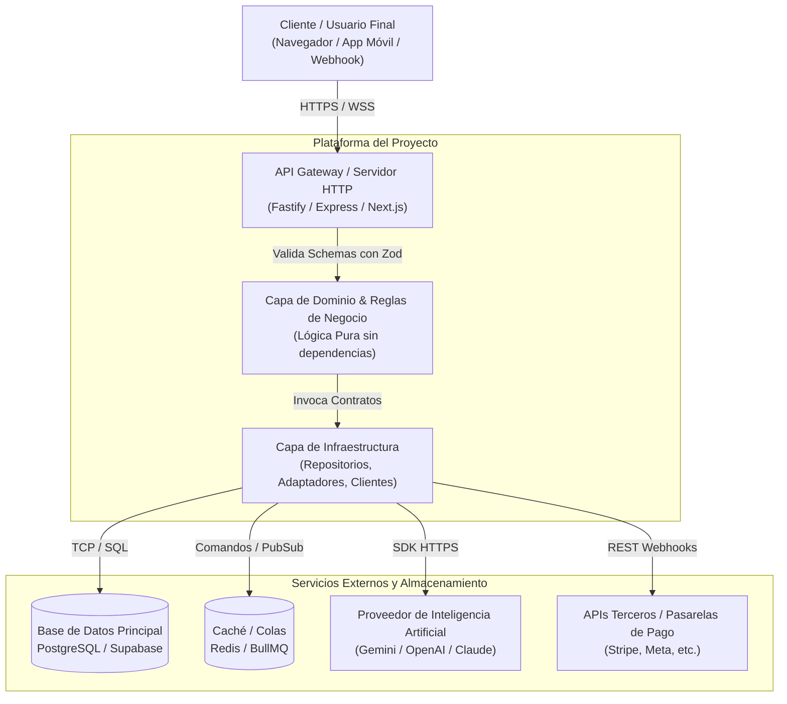

# ARQUITECTURA DEL SISTEMA: MAPA MENTAL Y FLUJO DE DATOS
## Proyecto: [NOMBRE_DEL_PROYECTO]

---

## 1. Visión General de Alto Nivel
Este documento plasma la topología, los componentes clave y las fronteras de integración del sistema, sirviendo como plano de referencia para humanos e Inteligencias Artificiales.

---

## 2. Diagrama de Contenedores y Flujo (C4 Model Nivel 2)

---

## 3. Catálogo de Puertos y Servicios Locales

| Componente / Servicio | Puerto Local | Protocolo | Endpoint de Salud |
|---|---|---|---|
| API Backend Principal | `3000` | HTTP/REST | `/health` |
| Frontend Web | `5173` o `3001` | HTTP | `/` |
| Base de Datos Local | `5432` | TCP/PostgreSQL | Ping nativo |
| Redis Cache | `6379` | TCP/Redis | Ping nativo |

---

## 4. Fronteras de Validación y Manejo de Errores
1. **Entrada de Datos:** Toda solicitud HTTP pasa por middleware de validación antes de alcanzar los controladores. Si la validación falla, se retorna error estándar `400 Bad Request` con detalles estructurados.
2. **Capa de Dominio:** Ningún modelo de base de datos se expone directamente a la interfaz pública (DTOs obligatorios).
3. **Manejo Centralizado de Excepciones:** Errores no controlados son interceptados, registrados con identificador de traza (`traceId`) y devueltos como `500 Internal Server Error` sin filtrar detalles sensibles.
