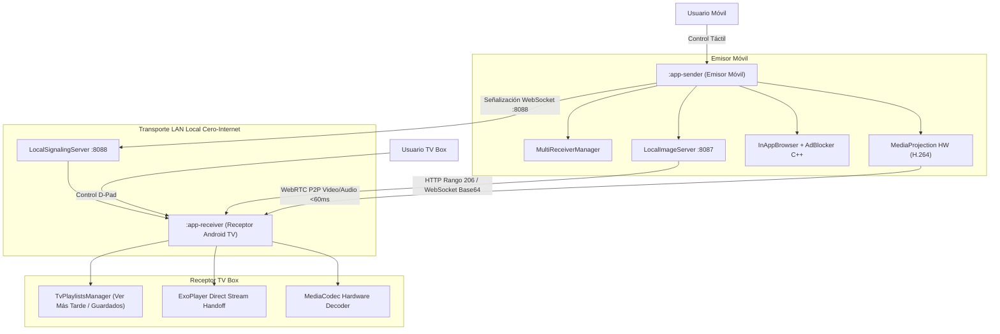

# ARQUITECTURA DEL SISTEMA: OMNICAST PRO

## 1. Visión General de Alto Nivel
OmniCast Pro es un sistema cliente-servidor nativo de Android diseñado bajo los principios de Clean Architecture y Arquitectura Hexagonal (Ports & Adapters).

El plano completo de diseño y los requerimientos funcionales aprobados se encuentran centralizados en el documento canónico:
👉 [**`doc/DESIGN.md`**](file:///home/sataca/Descargas/APLICACIONES/proyectarAplicacion/doc/DESIGN.md)

---

## 2. Diagrama de Contenedores y Flujo (C4 Model Nivel 2)

---

## 3. Catálogo de Puertos y Servicios Locales

| Componente / Servicio | Puerto Local | Protocolo | Propósito |
|---|---|---|---|
| Servidor de Señalización TV Box | `:8088` | WebSocket / TCP | Control P2P, estado de reproducción, comandos remotos. |
| Servidor Multimedia Móvil | `:8087` | HTTP / TCP | Servicio de videos de galería local con cabeceras `206 Partial Content`. |
| Descubrimiento de Red (NSD/mDNS) | Dinámico | UDP (`_omnicast._tcp`) | Detección automática cero-configuración de TVs en LAN. |

---

## 4. Registro de Decisiones de Arquitectura (ADRs)
- [ADR-001: Stack Tecnológico Inicial](file:///home/sataca/Descargas/APLICACIONES/proyectarAplicacion/doc/adr/ADR-001-stack-inicial.md)
- [ADR-002: Telemetría y Logs en TV Box](file:///home/sataca/Descargas/APLICACIONES/proyectarAplicacion/doc/adr/ADR-002-telemetria-tv-logs.md)
- [ADR-003: Estrategia de Renovación de Enlaces Expirados en TV (QR + Sustitución TTL)](file:///home/sataca/Descargas/APLICACIONES/proyectarAplicacion/doc/adr/ADR-003-estrategia-renovacion-enlaces-tv.md)
