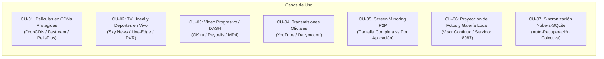
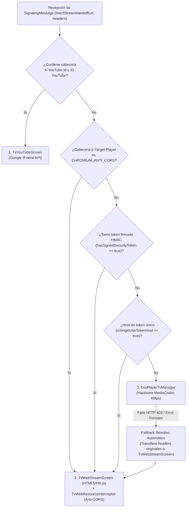
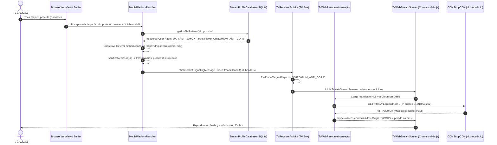
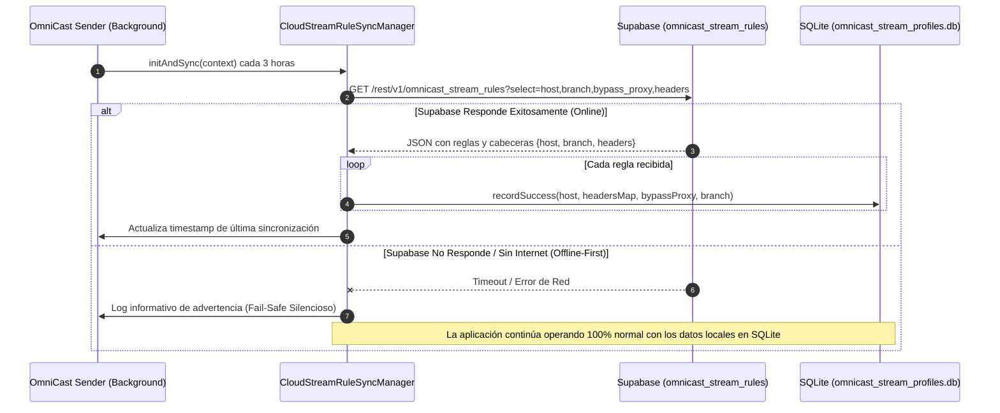

# 🏛️ ARQUITECTURA DEL SISTEMA: OMNICAST PRO

**Versión Canónica:** v3.5.58  
**Última actualización:** 2026-10-31  
**Estándar de Calidad:** Clean Architecture, Arquitectura Hexagonal (Ports & Adapters), Offline-First, Fail-Fast, Zero-Crash  

---

## 1. Visión General de Alto Nivel

OmniCast Pro es un ecosistema cliente-servidor nativo de Android diseñado para la transmisión multimedia y proyección de pantalla de baja latencia con tolerancia extrema a fallos:
1. **Emisor Móvil (`:app-sender`):** Transmisión de pantalla de baja latencia (<60ms) por WebRTC, captura de audio digital interno, proyección de fotos/videos locales y navegador web con bloqueador de publicidad en C++20, gobernanza de identidades por SQLite local y captura universal de medios con lista plana estándar Web Video Caster.
2. **Receptor Android TV / TV Box (`:app-receiver`):** Pantalla de standby limpia, receptor WebRTC por hardware, reproductor híbrido dual (ExoPlayer por hardware para flujos VOD/Live/MP4/DASH y Chromium HTML5 + Hls.js con interceptor anti-CORS para CDNs protegidas) y control ergonómico por mando a distancia D-Pad.
3. **Núcleo Compartido (`:core:domain`, `:core:protocol`, `:core:telemetry`):** Modelos puros de dominio, máquina de estados de señalización WebRTC, protocolos de control P2P y telemetría en tiempo real con timestamps.

El contrato funcional y el mapa detallado de código se encuentran en:
👉 [**`doc/DESIGN.md`**](file:///home/sataca/Descargas/APLICACIONES/proyectarAplicacion/doc/DESIGN.md)  
👉 [**`doc/MAPA_DEL_SISTEMA_Y_FLUJO_DE_CODIGO.md`**](file:///home/sataca/Descargas/APLICACIONES/proyectarAplicacion/doc/MAPA_DEL_SISTEMA_Y_FLUJO_DE_CODIGO.md) *(Call graph paso a paso de archivo a archivo)*

---

## 2. Diagrama de Contenedores y Flujo (C4 Model Nivel 2)

```mermaid
graph TD
    User["Usuario Móvil"] -->|Control Táctil| SenderApp[":app-sender (Emisor Móvil)"]
    TVUser["Usuario TV Box"] -->|Control D-Pad / Tecla| ReceiverApp[":app-receiver (Receptor Android TV)"]

    subgraph Emisor Móvil
        SenderApp --> MediaProj["MediaProjection HW (H.264)"]
        SenderApp --> WebBrowser["InAppBrowser + AdBlocker C++ & Kotlin"]
        SenderApp --> SqliteProfiles["SQLite (omnicast_stream_profiles.db)"]
        SenderApp --> CloudSync["CloudStreamRuleSyncManager"]
        SenderApp --> PhotoServer["LocalImageServer :8087"]
        SenderApp --> MultiCastMgr["MultiReceiverManager"]
    end

    subgraph Nube Supabase (Crowdsourced)
        CloudSync -.->|Sincronización Periódica 3h| SupabaseRules["omnicast_stream_rules (Cloud)"]
    end

    subgraph Transporte LAN Local Cero-Internet
        MediaProj -->|WebRTC P2P Video/Audio <60ms| ReceiverApp
        PhotoServer -->|HTTP Rango 206 / WebSocket Base64| ReceiverApp
        SenderApp -->|Señalización WebSocket :8088| LocalSigServer["LocalSignalingServer :8088"]
    end

    subgraph Receptor TV Box (100% Pasivo)
        LocalSigServer --> ReceiverApp
        ReceiverApp --> HWDecoder["MediaCodec Hardware Decoder"]
        ReceiverApp --> DualPlayer{"Enrutador TvReceiverActivity"}
        DualPlayer -->|X-Target-Player: EXOPLAYER / VOD / Live / DASH| ExoPlayerTV["ExoPlayer Hardware"]
        DualPlayer -->|X-Target-Player: CHROMIUM_ANTI_CORS / Tokens HMAC| TvWebStream["TvWebStreamScreen (HTML5/Hls.js)"]
        TvWebStream --> AntiCors["TvWebResourceInterceptor (Anti-CORS 0ms + Access-Control-Allow-Origin: *)"]
        ReceiverApp --> TVPlaylists["TvPlaylistsManager (PVR / Guardados / Historial)"]
    end
```

---

## 3. Gobernanza Dinámica por SQLite y Resiliencia Offline-First (ADR-016 / HU-018)

Para erradicar código duro (`if-else` encadenados por nombres de servidores) y adaptarse dinámicamente a cambios en servidores de streaming sin necesidad de recompilar APKs:

```mermaid
flowchart TD
    Cloud["Repositorios Comunitarios / Supabase\n(omnicast_stream_rules)"] -->|GET cada 3h (select=host,branch,bypass_proxy,headers)| Sync["CloudStreamRuleSyncManager"]
    
    subgraph Almacenamiento Local Celular (Offline-First)
        Sync -->|Persistencia en stream_profiles| SQLite[("SQLite Local\nomnicast_stream_profiles.db")]
        Seeds["Perfiles Semilla Iniciales\n(StreamManifestProbe.DEFAULT_HOST_PROFILES)"] -->|Carga Inicial en Frío| SQLite
    end
    
    Browser["Navegador Móvil / Detección de Video\n(MediaPlatformResolver.kt)"] -->|getProfileForHost(host)| SQLite
    SQLite -->|Retorna: User-Agent, X-Target-Player, Referer| Resolver["Preparador de Transmisión\n(buildSafeHeaders)"]
    Resolver -->|Despacho con Cabeceras Exactas| TV["TV Box (Receptor Pasivo)"]
```

### Principios de la Gobernanza SQLite:
1. **Offline-First:** La app nunca depende de la conexión con Supabase para funcionar. Las cabeceras e identidades se leen directamente de SQLite local.
2. **Resiliencia ante Fallos de Red:** Si Supabase cae, la aplicación opera indefinidamente con la última versión guardada en SQLite.
3. **Cero Hardcoding de Identidades:** Se eliminan asignaciones estáticas en código. Si una CDN exige identidad de escritorio Windows (`UA_FASTREAM`) o móvil, se gobierna por la tabla `stream_profiles`.
4. **Ley de Preservación Fiel del Host de CDN (Anti-Private RFC 1918 Leak):** Queda prohibido alterar o reescribir el nombre de host asignado por la CDN (`r1.dropcdn.io`) mediante parámetros query (`srv=`). Se erradica la mutación hacia subdominios privados internos (`ds1i.dropcdn.io` / `192.168.10.23`).

---

## 4. Los 4 Escudos Defensivos del Navegador y Bloqueador de Anuncios

```mermaid
flowchart TD
    Req["Petición / Evento Web"] --> S1{"1. Motor C++ Nativo\n(libadblock-client.so)"}
    S1 -->|Dominio o Regla en EasyList| Block1["Descarte Inmediato\nen Socket (0ms)"]
    S1 -->|Recurso Legítimo| S2{"2. Evento Popup\n(onCreateWindow)"}
    
    S2 -->|window.open() publicitario| Block2["return false Nativo\n(0 MB RAM - Anti-OOM)"]
    S2 -->|Navegación Normal| S3{"3. Neutralizador DOM\n(click-shield.js)"}
    
    S3 -->|Capa invisible sobre Play| Block3["Captura de Evento y Remoción\ndel Elemento Trampa"]
    S3 -->|Toque Limpio| S4{"4. Sonda y Clasificador\n(Hexagonal Core)"}
    
    S4 -->|VAST / Popunder en Iframe| Block4["Filtrado por AdBlocker.kt\ny Respuesta Vacía"]
    S4 -->|Flujo de Video Válido| Media["Clasificación en 6 Ramas\ny Registro de Enlace"]
```

1. **Escudo 1 (Socket de Red en C++20):** `NativeAdBlockEngine.cpp` evalúa URLs en microsegundos contra 34,803 reglas estáticas de EasyList y dominios aprendidos en SQLite local.
2. **Escudo 2 (Supresión Nativa de Popups Anti-OOM):** `BrowserWebView.kt` maneja `onCreateWindow` retornando `false`. Elimina instancias de WebView temporales que saturan los 512 MB del heap, neutralizando popups con 0 MB de consumo de RAM.
3. **Escudo 3 (Neutralizador DOM de Capas Trampa):** Script reactivo que desactiva capas transparentes con alto `z-index` posicionadas sobre reproductores web de películas.
4. **Escudo 4 (Filtro de Telemetría y Pausa de Memoria):** Al iniciar el casteo, `BrowserWebView` pausa el video local (`video.pause()`) para liberar decodificadores de hardware y RAM, evitando crashes del renderizador de Chromium (`code -1`).

---

## 5. Casos de Uso Principales (Use Cases)



### Detalle de Casos de Uso:
* **CU-01 (Películas en CDNs Protegidas):** El usuario navega en un portal de películas (ej. *Sacrifice* en PelisPlus). El sniffer detecta el flujo HLS. `MediaPlatformResolver` consulta SQLite, inyecta `UA_FASTREAM`, el Referer canónico del embed (`https://dr0pstream.com/e/<id>`) y la directiva `X-Target-Player: CHROMIUM_ANTI_CORS`. La TV Box recibe la URL pública intacta (`r1.dropcdn.io`), `TvWebResourceInterceptor` responde preflights OPTIONS e inyecta CORS, y Chromium reproduce de inmediato sin error `code=0`.
* **CU-02 (TV Lineal y Deportes en Vivo):** Canales de emisión continua 24/7 (Sky News, partidos en vivo). El clasificador en C++ detecta descriptores `linear`, `lin-`, `envivo`. El Sender fuerza `startPositionMs = 0L`. ExoPlayer se ancla a la cabeza en vivo (*live edge*) sin buffering infinito. En la TV se muestra la insignia `🔴 EN VIVO` y se habilita la grabación continua PVR con un toque.
* **CU-03 (Video Progresivo y DASH):** OK.ru o servidores directos MP4/MKV. Despacho directo a `ExoPlayerTvManager` con decodificación acelerada por hardware a 60 fps, soporte de saltos temporales (±10s) y preservación de cabeceras seguras.
* **CU-04 (YouTube Oficial y Canales Embebidos):** Detección semántica de IDs oficiales (11 caracteres o canales de 24 caracteres `channel=UC...`). Despacho directo a `TvYouTubeScreen` mediante IFrame oficial de Google sin anuncios invasivos.
* **CU-05 (Screen Mirroring P2P):** Captura de pantalla y audio interno (<60ms). Modo Pantalla Completa con relación vertical 1.075f sin barras de sistema vs Modo Por Aplicación con lienzo 16:9 libre y orientación por frame de video.
* **CU-06 (Proyección de Fotos y Galería Local):** Servidor HTTP local en puerto `:8087`. Navegación continua de fotos con botón Atrás LIFO estricto y sin recarga de sockets.
* **CU-07 (Sincronización Nube-a-SQLite):** En segundo plano cada 3 horas, `CloudStreamRuleSyncManager` actualiza las reglas comunitarias desde Supabase hacia la base de datos local SQLite.

---

## 6. Árbol de Decisión Estricto de Reproducción en TV Box



---

## 7. Diagramas de Interacción y Secuencia

### 7.1. Proyección de Película en CDN Protegida (DropCDN / Fastream / PelisPlus)



### 7.2. Sincronización Remota Nube -> SQLite con Resiliencia Offline



---

## 8. Leyes Técnicas Inviolables de Hardware y Streaming

1. **Ley de Intocabilidad de lo Probado:** Toda pantalla, extractor, cálculo de escala o flujo aprobado por el usuario queda sellado e inmutable. Si funciona, no se toca.
2. **Prohibición de `changeCaptureFormat()` en caliente:** En Screen Mirroring, el codec H.264 por hardware no admite redimensionamiento durante la transmisión. La rotación fluye nativamente en el frame.
3. **Tolerancia a `IceConnectionState.DISCONNECTED`:** Al ser un estado transitorio de red, nunca expulsa la pantalla de la TV. Solo `FAILED` o `CLOSED` son causales de cierre.
4. **Comando STOP Inmediato:** Todo mensaje `PlayControl("STOP")` apaga la transmisión y restaura Standby en menos de 5ms.
5. **Intocabilidad de Foco en `BrowserWebView`:** Prohibido forzar `requestFocus()` táctil en el WebView para no romper la conexión IME del teclado virtual.
6. **Supresión Nativa de Popups Anti-OOM:** `onCreateWindow` retorna `false` directamente para evitar saturar el límite de 512 MB de la máquina virtual.
7. **Delimitación Estricta de Rutas URL (Ley RFC 8216):** Las comparaciones de manifiestos HLS (`master.m3u8`) deben exigir delimitador de barra (`endsWith("/$name")`) o segmento final de ruta.
8. **Preservación Fiel de Dominios CDN y TV Box Pasiva (Ley Anti-Private RFC 1918 Leak / ADR-016):**
   - Prohibido reescribir nombres de host mediante parámetros query como `srv=`.
   - La TV Box actúa de forma estrictamente pasiva sin alterar URLs recibidas del Emisor.

---

## 9. Registro de Decisiones de Arquitectura (ADRs)

- [ADR-001: Stack Tecnológico Inicial](file:///home/sataca/Descargas/APLICACIONES/proyectarAplicacion/doc/adr/ADR-001-stack-inicial.md)
- [ADR-002: Telemetría y Logs en TV Box](file:///home/sataca/Descargas/APLICACIONES/proyectarAplicacion/doc/adr/ADR-002-telemetria-tv-logs.md)
- [ADR-003: Estrategia de Renovación de Enlaces Expirados en TV (QR + Sustitución TTL)](file:///home/sataca/Descargas/APLICACIONES/proyectarAplicacion/doc/adr/ADR-003-estrategia-renovacion-enlaces-tv.md)
- [ADR-004: Arquitectura Escalonada de Costo $0 (Clases Deterministas + Auto-Curación IA Gratuita OTA)](file:///home/sataca/Descargas/APLICACIONES/proyectarAplicacion/doc/adr/ADR-004-arquitectura-auto-recuperacion-ia-ota.md)
- [ADR-005: Aprendizaje Proactivo de Bloqueo de Anuncios y Resiliencia de Streams](file:///home/sataca/Descargas/APLICACIONES/proyectarAplicacion/doc/adr/ADR-005-aprendizaje-proactivo-bloqueo-anuncios-resiliencia-streams.md)
- [ADR-006: Motor Nativo C++20 de Captura de Streams, 6 Ramas y Aprendizaje en la Nube](file:///home/sataca/Descargas/APLICACIONES/proyectarAplicacion/doc/adr/ADR-006-motor-nativo-cpp-captura-streams-nube-ui-tokens.md)
- [ADR-007: Receptor Web HTML5 (Chromium / Hls.js) y Resiliencia ante CDNs Protegidas](file:///home/sataca/Descargas/APLICACIONES/proyectarAplicacion/doc/adr/ADR-007-receptor-web-html5-tv-hlsjs-resiliencia-cdn.md)
- [ADR-008: Estabilización de Caret React y Scroll Centrado en Búsqueda](file:///home/sataca/Descargas/APLICACIONES/proyectarAplicacion/doc/adr/ADR-008-estabilizacion-caret-react-y-scroll-centrado-busqueda.md)
- [ADR-009: Asistente Nativo Flotante de Entrada de Texto Web y Pipeline de Sugerencias en Vivo](file:///home/sataca/Descargas/APLICACIONES/proyectarAplicacion/doc/adr/ADR-009-asistente-nativo-flotante-entrada-web-sugerencias.md)
- [ADR-010: Supresión Nativa de Popups Anti-OOM, Blindaje de Gestos y Control Dual D-Pad en TV](file:///home/sataca/Descargas/APLICACIONES/proyectarAplicacion/doc/adr/ADR-010-supresion-nativa-popups-anti-oom-control-dual-dpad.md)
- [ADR-011: Arquitectura Fiel de Captura v3.32.94 y Despacho Dual de Reproductores en TV Box](file:///home/sataca/Descargas/APLICACIONES/proyectarAplicacion/doc/adr/ADR-011-arquitectura-captura-v3.32-y-despacho-dual-tv.md)
- [ADR-012: Filtro Centralizado de Higiene de Red y Purificación de Extractores Hexagonales](file:///home/sataca/Descargas/APLICACIONES/proyectarAplicacion/doc/adr/ADR-012-filtro-centralizado-higiene-streams-y-adaptadores-limpios.md)
- [ADR-013: Coexistencia DropCDN/OK.ru, Estándar WVC de Lista Plana y Blindaje de Cabeceras en TV](file:///home/sataca/Descargas/APLICACIONES/proyectarAplicacion/doc/adr/ADR-013-coexistencia-dropcdn-okru-y-estandar-lista-plana.md)
- [ADR-014: Resolución Universal Master HLS (RFC 8216) y Canales YouTube Live](file:///home/sataca/Descargas/APLICACIONES/proyectarAplicacion/doc/adr/ADR-014-resolucion-universal-master-hls-y-canales-youtube-live.md)
- [ADR-015: Clasificación Universal de TV Lineal, Grabación Dual (PVR/Descarga) y Puente HTTP para Deep Link QR](file:///home/sataca/Descargas/APLICACIONES/proyectarAplicacion/doc/adr/ADR-015-clasificacion-universal-tv-lineal-pvr-y-puente-qr.md)
- [ADR-016: Gobernanza Dinámica por SQLite, Preservación Fiel de Dominios CDN y TV Box Pasiva](file:///home/sataca/Descargas/APLICACIONES/proyectarAplicacion/doc/adr/ADR-016-gobernanza-sqlite-resiliencia-dropcdn-y-tv-pasiva.md)
