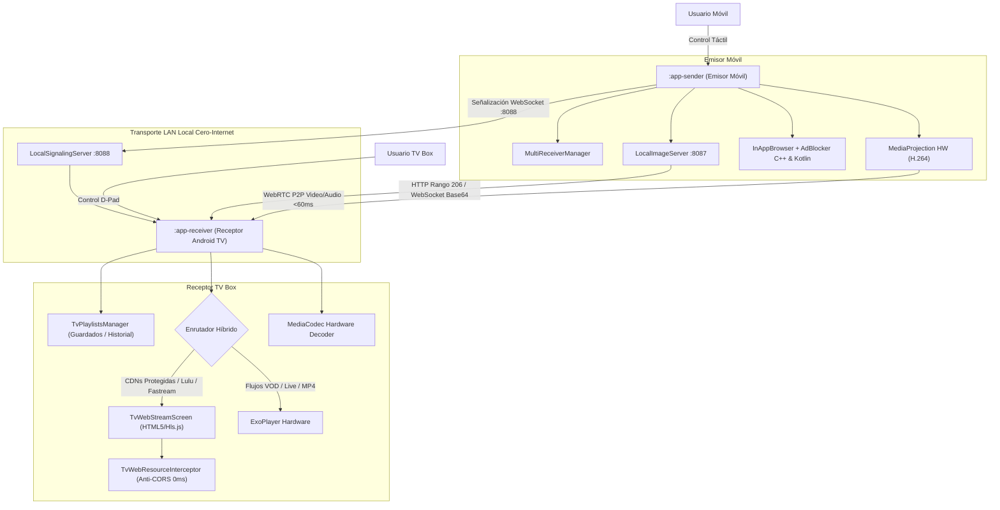

# 🏛️ ARQUITECTURA DEL SISTEMA: OMNICAST PRO

**Versión Canónica:** v3.4.60  
**Última actualización:** 2026-10-25  
**Estándar de Calidad:** Clean Architecture, Arquitectura Hexagonal (Ports & Adapters), Fail-Fast, Zero-Crash  

---

## 1. Visión General de Alto Nivel

OmniCast Pro es un ecosistema cliente-servidor nativo de Android compuesto por:
1. **Emisor Móvil (`:app-sender`):** Transmisión de pantalla de baja latencia (<60ms), captura de audio digital interno, proyección de fotos/videos locales y navegador web con bloqueador de publicidad multi-nivel y captura universal de medios.
2. **Receptor Android TV / TV Box (`:app-receiver`):** Pantalla de standby limpia, receptor WebRTC por hardware, reproductor híbrido dual (ExoPlayer para flujos directos / Chromium HTML5 + Hls.js para CDNs protegidas) y control ergonómico por mando a distancia D-Pad.
3. **Núcleo Compartido (`:core:domain`, `:core:protocol`, `:core:telemetry`):** Modelos puros de dominio, máquina de estados de señalización WebRTC, protocolos de control y telemetría en tiempo real.

El contrato funcional completo se encuentra en:
👉 [**`doc/DESIGN.md`**](file:///home/sataca/Descargas/APLICACIONES/proyectarAplicacion/doc/DESIGN.md)

---

## 2. Diagrama de Contenedores y Flujo (C4 Model Nivel 2)



---

## 3. Los 4 Escudos Defensivos del Navegador y Bloqueador de Anuncios

Para navegar en sitios de streaming sin caídas por falta de memoria ni desvíos engañosos, el sistema opera con 4 líneas de defensa:

```mermaid
flowchart TD
    Req["Petición / Evento Web"] --> S1{"1. Motor C++ Nativo\n(libadblock-client.so)"}
    S1 -->|Dominio o Regla en EasyList| Block1["Descarte Inmediato\nen Socket (0ms)"]
    S1 -->|Recurso Legítimo| S2{"2. Evento Popup\n(onCreateWindow)"}
    
    S2 -->|window.open() publicitario| Block2["return false Nativo\n(0 MB RAM - Anti-OOM)"]
    S2 -->|Navegación Normal| S3{"3. Neutralizador DOM\n(click-shield.js)"}
    
    S3 -->|Capa invisible sobre Play| Block3["Captura de Evento y Remoción\ndel Elemento Trampa"]
    S3 -->|Toque Limpio| S4{"4. Sonda y Clasificador\n(Hexagonal Core)"}
    
    S4 -->|VAST / Popunder en Iframe| Block4["Filtrado por AdBlocker.kt\ny Respuesta Vacía"]
    S4 -->|Flujo de Video Válido| Media["Clasificación en 6 Ramas\ny Registro de Enlace"]
```

1. **Escudo 1 (Socket de Red en C++20):** `NativeAdBlockEngine.cpp` evalúa URLs en microsegundos contra reglas estáticas de EasyList y dominios aprendidos en SQLite local.
2. **Escudo 2 (Enrutamiento Reutilizable Anti-OOM y Supresión de Popups):** `BrowserPopupInterceptor.kt` gestiona `onCreateWindow`. Enruta clics directos del usuario (`view.hitTestResult.extra`) y resultados de búsqueda (`target="_blank"`) hacia el WebView principal en 0ms. Utiliza un único interceptor estático con JavaScript deshabilitado para procesar `window.open` con gesto, descartando popups automáticos en 0ms con 0 MB de memoria adicional y erradicando el colapso del heap de 512 MB.
3. **Escudo 3 (Neutralizador de Capas en el DOM):** Script reactivo que desactiva capas transparentes con alto `z-index` posicionadas sobre reproductores web de películas.
4. **Escudo 4 (Filtro de Redes VAST / Autoaprendizaje Colectivo):** Detección de redirecciones y dominios foráneos con persistencia en `omnicast_adblock.db` y sincronización asíncrona hacia Supabase (`ADBLOCK_LEARNED_DOMAIN`).

---

## 4. Arquitectura Hexagonal de Detección de Medios (Principio "Poner y Sacar")

El motor de extracción y análisis de video sigue el patrón **Ports & Adapters**:

```mermaid
flowchart LR
    subgraph Sensores
        A["Sensor Red C++\n(NativeAdBlockEngine)"]
        B["Sniffer DOM\n(wvc_sniffer.js)"]
        C["Pre-Escáner Iframes\n(MoviePagePreScanner)"]
    end

    subgraph Puerto Hexagonal
        Port["IMediaStreamExtractorPort\n(DetectMediaStreamUseCase)"]
    end

    subgraph Adaptadores Aislados
        Ad1["MediaPlatformResolver\n(LuluStream / Fastream)"]
        Ad2["YouTubeQualityResolver\n(TvYouTubeScreen)"]
        Ad3["UniversalHlsExtractor\n(Master .m3u8)"]
    end

    subgraph Las 6 Ramas de Dominio
        R1["1. VOD_HLS_MP4 (Películas)"]
        R2["2. LIVE_HLS (En Vivo / Deportes)"]
        R3["3. DASH (.mpd)"]
        R4["4. AUDIO (Radios / AAC)"]
        R5["5. IPTV (Listas M3U)"]
        R6["6. LOCAL_MEDIA (Galería)"]
    end

    Sensores --> Port
    Port --> Adaptadores Aislados
    Adaptadores Aislados --> Las 6 Ramas de Dominio
```

### Las 6 Ramas de `MediaBranch`:
1. **`VOD_HLS_MP4`:** Películas y series con soporte para saltos de tiempo (scrubbing), persistencia de posición y pistas múltiples.
2. **`LIVE_HLS`:** Canales de televisión y partidos en vivo (sin `#EXT-X-ENDLIST`), con buffer ultracorto y enganche en el borde en vivo.
3. **`DASH`:** Manifiestos XML `.mpd` con canales separados de audio y video.
4. **`AUDIO`:** Emisiones de radio y pistas de sonido puro, apagando el lienzo gráfico para ahorrar batería.
5. **`IPTV`:** Listas masivas de canales M3U con reconexión silenciosa tolerante a cortes.
6. **`LOCAL_MEDIA`:** Fotos y videos de la memoria del teléfono servidos por el puerto `:8087` con cabeceras `206 Partial Content`.

---

## 5. Arquitectura Híbrida Dual en la TV Box

La TV Box dispone de 3 motores autónomos según la naturaleza del flujo recibido vía `SignalingMessage.DirectStreamHandoff`:

```mermaid
flowchart TD
    Handoff["DirectStreamHandoff(url, headers, branch)"] --> Check{"¿Tipo de Enlace?"}
    Check -->|YouTube ID| YT["TvYouTubeScreen\n(Embed TV sin anuncios)"]
    Check -->|Token Firmado / CDN Protegida\n(LuluStream / Fastream)| WebPlayer["TvWebStreamScreen\n(Chromium + Hls.js)"]
    Check -->|MP4 / HLS Abierto / En Vivo / IPTV| Exo["ExoPlayerTvManager\n(Decodificación HW)"]
    Exo -->|Fallback ante HTTP 403| WebPlayer
    
    subgraph Blindaje de Red en TV
        WebPlayer --> Interceptor["TvWebResourceInterceptor"]
        Interceptor -->|OPTIONS Preflight| Resp200["Respuesta 200 (0ms)"]
        Interceptor -->|Segmentos .ts / .m3u8| JavaSocket["Socket Nativo Java + CORS *"]
    end

    subgraph Ergonomía D-Pad
        Remote["Mando a Distancia"] --> KeyHandler["TvRemoteKeyHandler"]
        KeyHandler -->|D-Pad Arriba| Subs["💬 Alternar Subtítulos (Badge 2.5s)"]
        KeyHandler -->|D-Pad Abajo| Qual["📺 Ciclar Calidad HLS (Badge 2.5s)"]
        KeyHandler -->|D-Pad Center| PlayPause["⏯ Play / Pausa"]
        KeyHandler -->|D-Pad Left/Right| Seek["⏩ Salto ±10 segundos"]
        KeyHandler -->|MENU| Zoom["🔍 Ciclar Zoom (FIT / FILL / 75-130%)"]
    end
```

---

## 6. Screen Mirroring y Leyes de Hardware

El subsistema de Screen Mirroring conecta la pantalla del móvil con la TV Box vía WebRTC P2P con latencia inferior a 60ms:

- **Leyes Técnicas Inviolables:**
  1. **Prohibido `changeCaptureFormat()` en caliente:** El codec H.264 por hardware y el `VirtualDisplay` no admiten redimensionamiento durante la transmisión. La rotación fluye nativamente en el frame.
  2. **Tolerancia a `IceConnectionState.DISCONNECTED`:** Al ser un estado transitorio de red, nunca expulsa la pantalla de la TV. Solo `FAILED` o `CLOSED` son causales de cierre.
  3. **Comando STOP Inmediato:** Todo mensaje `PlayControl("STOP")` apaga la transmisión y restaura Standby en menos de 5ms.
- **Separación Total de Opciones:**
  - **Opción 1: Pantalla Completa:** Mantiene la proporción vertical 100% de la altura de la TV (`aspectRatio`), aplicando factor base de 1.075f en modo FIT para ocultar las barras de sistema.
  - **Opción 2: Por Aplicación:** Ignora el sensor físico del teléfono y obedece la orientación del video (`effectiveFrameW > effectiveFrameH`) en un lienzo libre 16:9 (`MATCH_PARENT`) con zoom gradual.

---

## 7. Catálogo de Puertos y Protocolos Locales

| Componente / Servicio | Puerto Local | Protocolo | Propósito |
|---|---|---|---|
| Servidor de Señalización TV Box | `:8088` | WebSocket / TCP | Control P2P, estado de reproducción, comandos remotos. |
| Servidor Multimedia Móvil | `:8087` | HTTP / TCP | Streaming de videos locales con rango `206 Partial Content`. |
| Descubrimiento de Red (NSD/mDNS) | Dinámico | UDP (`_omnicast._tcp`) | Detección automática cero-configuración de TVs en la red WiFi. |

---

## 8. Registro de Decisiones de Arquitectura (ADRs)

- [ADR-001: Stack Tecnológico Inicial](file:///home/sataca/Descargas/APLICACIONES/proyectarAplicacion/doc/adr/ADR-001-stack-inicial.md)
- [ADR-002: Telemetría y Logs en TV Box](file:///home/sataca/Descargas/APLICACIONES/proyectarAplicacion/doc/adr/ADR-002-telemetria-tv-logs.md)
- [ADR-003: Estrategia de Renovación de Enlaces Expirados en TV (QR + Sustitución TTL)](file:///home/sataca/Descargas/APLICACIONES/proyectarAplicacion/doc/adr/ADR-003-estrategia-renovacion-enlaces-tv.md)
- [ADR-004: Arquitectura Escalonada de Costo $0 (Clases Deterministas + Auto-Curación IA Gratuita OTA)](file:///home/sataca/Descargas/APLICACIONES/proyectarAplicacion/doc/adr/ADR-004-arquitectura-auto-recuperacion-ia-ota.md)
- [ADR-005: Aprendizaje Proactivo de Bloqueo de Anuncios y Resiliencia de Streams](file:///home/sataca/Descargas/APLICACIONES/proyectarAplicacion/doc/adr/ADR-005-aprendizaje-proactivo-bloqueo-anuncios-resiliencia-streams.md)
- [ADR-006: Motor Nativo C++20 de Captura de Streams, 6 Ramas y Aprendizaje en la Nube](file:///home/sataca/Descargas/APLICACIONES/proyectarAplicacion/doc/adr/ADR-006-motor-nativo-cpp-captura-streams-nube-ui-tokens.md)
- [ADR-007: Receptor Web HTML5 (Chromium / Hls.js) y Resiliencia ante CDNs Protegidas](file:///home/sataca/Descargas/APLICACIONES/proyectarAplicacion/doc/adr/ADR-007-receptor-web-html5-tv-hlsjs-resiliencia-cdn.md)
- [ADR-008: Estabilización de Caret React y Scroll Centrado en Búsqueda](file:///home/sataca/Descargas/APLICACIONES/proyectarAplicacion/doc/adr/ADR-008-estabilizacion-caret-react-y-scroll-centrado-busqueda.md)
- [ADR-009: Asistente Nativo Flotante de Entrada de Texto Web y Pipeline de Sugerencias en Vivo](file:///home/sataca/Descargas/APLICACIONES/proyectarAplicacion/doc/adr/ADR-009-asistente-nativo-flotante-entrada-web-sugerencias.md)
- [ADR-010: Supresión Nativa de Popups Anti-OOM, Blindaje de Gestos y Control Dual D-Pad en TV](file:///home/sataca/Descargas/APLICACIONES/proyectarAplicacion/doc/adr/ADR-010-supresion-nativa-popups-anti-oom-control-dual-dpad.md)
