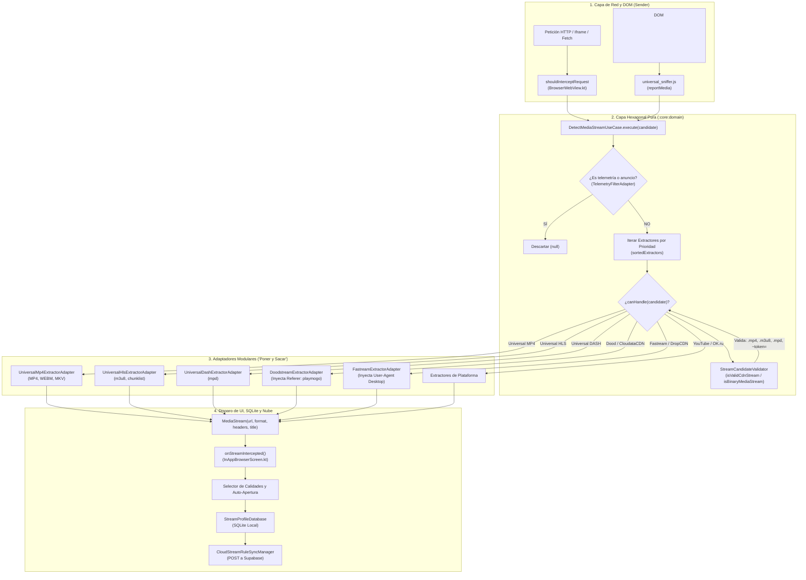

# ADR-018: Detección Dual en Tenaza (Red + DOM) y Validador Binario Estructural para CDNs Ofuscadas

**Estado:** Aprobado  
**Fecha:** 2026-11-04  
**Versión de Implementación:** v3.5.89 (Sender: 340 / Receiver: 323)  
**Módulos Afectados:** `:core:domain`, `:app-sender`  

---

## 1. Contexto y Problema

En las aplicaciones de Screen Mirroring y Web Video Casting, la captura de video se enfrenta a dos escenarios antagónicos en la web moderna:

1. **Escenario A — Iframes Protegidos y Sandboxed (Cinecalidad, Pelisplus, Doodstream):**
   El reproductor de video reside dentro de un iframe alojado en un dominio externo (cross-origin). Por la política de seguridad estricta del navegador (**Same-Origin Policy**), el JavaScript inyectado en el marco principal (`universal_sniffer.js`) tiene terminantemente bloqueado el acceso al árbol DOM del iframe (`contentDocument` es nulo o dispara `DOMException: Blocked a frame with origin`). Para el DOM, el video no existe y el contador permanece en '0'.

2. **Escenario B — SPAs y Reproductores Ricos en JavaScript (YouTube Polymer, JWPlayer, Video.js):**
   Las aplicaciones de una sola página no recargan la ventana al cambiar de video. Asimismo, reproductores como JWPlayer configuran en memoria de JavaScript listas con múltiples calidades (1080p, 720p, 480p) y cargan anuncios preroll de 15 a 30 segundos. En la red no viaja un archivo continuo, sino fragmentos efímeros sin metadatos de duración.

3. **La Trampa de los Dominios Rotativos en CDNs (Doodstream, PlayMogo, CloudataCDN):**
   Las redes CDN cambian de dominio continuamente (`doodcdn` -> `doopstream` -> `ds2play` -> `cloudatacdn.com` -> `[hash]~[token]`). Hardcodear nombres de dominios específicos en el código Kotlin o scripts JavaScript condena a la aplicación a quedar ciega ante cada rotación de infraestructura.

---

## 2. Decisión Arquitectónica

Se adopta una **Arquitectura en Tenaza (Dual Pinch Strategy)** y un **Validador Binario Estructural** basado en datos puros:



### Principios Fundamentales:

1. **La Tenaza Dual Complementaria:**
   * **Brazo de Red (`shouldInterceptRequest`):** Intercepta el 100% de los paquetes crudos emitidos por Android, independientemente de si provienen de un iframe cross-origin, un web worker o una llamada XHR ofuscada. Extrae la URL real del video y su cabecera `Referer` legítima (`docUrl`).
   * **Brazo de DOM (`universal_sniffer.js`):** Monitorea la etiqueta `<video>`, lee metadatos físicos de decodificación (`video.duration`, `videoWidth`), descarta anuncios comerciales (< 60 segundos), extrae calidades de JWPlayer/Clappr y escucha eventos de navegación SPA en YouTube.

2. **Validador Binario Estructural (`StreamCandidateValidator.kt`):**
   * En lugar de buscar nombres de dominios rotativos, valida la **firma matemática/estructural de entrega**:
     ```kotlin
     (lower.contains("~") && lower.contains("token=") && lower.contains("expiry=")) ||
     lower.contains(".m3u8") || lower.contains(".mp4") || lower.contains("/pass/") ...
     ```
   * Descarta sistemáticamente documentos web (`.html`, `.js`, `.css`), assets (`.png`, `.woff2`) y rutas de páginas web o iframes (`/embed/`, `/e/`, `/cdn-cgi/`, `/pass_md5/`).

3. **Ciclo de Gobernanza Dinámica por Datos (SQLite + Supabase):**
   * **Local (0 ms):** `StreamProfileDatabase` almacena el host, las cabeceras ganadoras y el reproductor objetivo (`EXOPLAYER` o `WEBVIEW`).
   * **Comunitario:** Tras 2 minutos de reproducción continua sin fallos, `CloudStreamRuleSyncManager` reporta la regla verificada a Supabase (`omnicast_stream_rules`), propagándola a todos los dispositivos sin necesidad de recompilar ni desplegar un nuevo APK.

---

## 3. Consecuencias

### Positivas:
* **Cobertura Total:** Sitios con iframes cerrados (Cinecalidad, Pelisplus) y sitios con APIs de JS (YouTube, JWPlayer) son capturados con 100% de fiabilidad.
* **Inmunidad ante Cambios de Dominio:** Las CDNs pueden rotar de subdominio diariamente; la estructura criptográfica del token (`~` + `token=` + `expiry=`) garantiza la detección en 0 ms.
* **Cero Publicidad Falsa:** Los anuncios preroll (< 60 s) se descartan en el DOM y nunca sustituyen a la película real.
* **Cumplimiento de AGENTS.md:** Se preserva la arquitectura hexagonal pura en `:core:domain`, desacoplada de la UI y de las WebViews de Android.

### Neutrales / Mitigadas:
* *Sobrecarga de Red:* `shouldInterceptRequest` filtra extensiones estáticas comunes (`.css`, `.js`, `.png`) en el primer condicional para no saturar CPU con inspecciones de candidate innecesarias.
