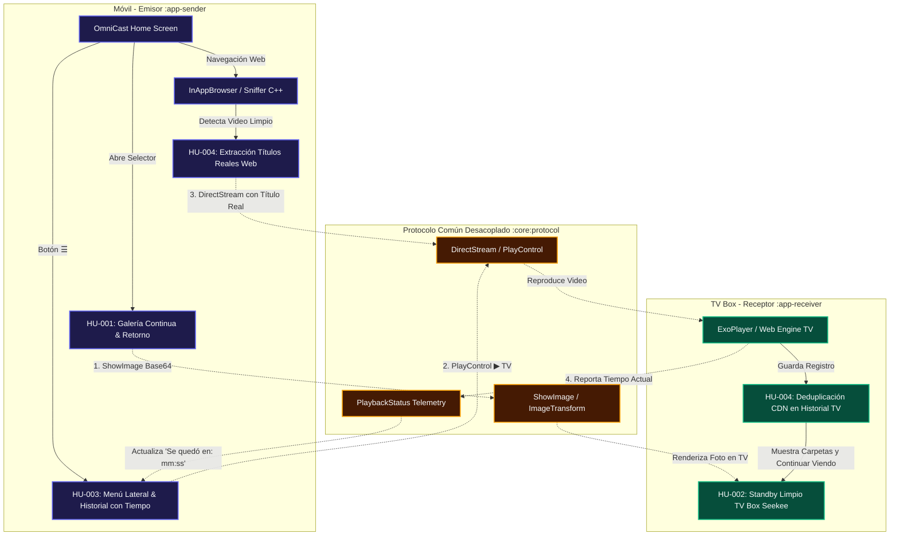

# 🌳 ÁRBOL DE RELACIONES Y FUNCIONAMIENTO DE LA APK (Feature Dependency Graph)

Este documento describe el **árbol de dependencias, relaciones y desacoplamiento** entre las diferentes Historias de Usuario (HU) y los componentes de la APK.

---

## 1. Principio Fundamental: Cero Acoplamiento Directo (Zero Tight Coupling)
- Las Historias de Usuario en OmniCast **no deben tener acoplamiento rígido entre sí**.
- Una modificación en la interfaz de la TV (`HU-002`) no puede afectar la navegación de la galería en el móvil (`HU-001`).
- La única vía de comunicación entre el móvil (`:app-sender`) y la TV (`:app-receiver`) es el **Protocolo de Señalización Inmutable (`:core:protocol`)** mediante mensajes WebSocket tipados (`SignalingMessage`).

---

## 2. Mapa Visual de Relaciones y Flujos



---

## 3. Matriz de Impacto y Aislamiento por Historia

| Historia de Usuario | Ámbito / Módulo | Depende de | Afecta a | Nivel de Acoplamiento |
|---|---|---|---|---|
| **HU-001 (Galería Fotos)** | `:app-sender` | `GalleryPickerActivity`, `PhotoCastViewerActivity` | `SignalingMessage.ShowImage` en TV | 🟢 **Bajo (Totalmente Aislado):** Cambiar el visor o el botón Atrás no impacta a la web ni al menú lateral. |
| **HU-002 (Standby Limpio TV)** | `:app-receiver` | `TvStandbyCleanScreen`, `TvCleanComponents` | Vista de espera en TV Box | 🟢 **Bajo:** Modificar el diseño o dock no altera el reproductor ExoPlayer ni al móvil. |
| **HU-003 (Menú Lateral Móvil)** | `:app-sender` | `SideMediaDrawer`, `PlayHistoryManager` | Emisión de `SignalingMessage.DirectStream` | 🟡 **Medio (Consumidor):** Consume el evento de telemetría de la TV para mostrar `Se quedó en: mm:ss`. |
| **HU-004 (Anti-Duplicados Web)** | `:app-sender` y `:app-receiver` | `DynamicSnifferManager`, `TvPlaybackHistoryManager` | Normalización de títulos en ambos extremos | 🟢 **Bajo:** Normaliza URLs antes de guardarlas; no afecta el motor WebRTC ni la galería. |

---

## 4. Flujo de Navegación Inversa de HU-001 (Pila de Actividades / Back Stack)

El principio de navegación inversa solicitado exige que la pila de Android se comporte como una pila LIFO estricta:

```
[Paso 0: OmniCast SenderMainActivity]
       │
       ▼ (Pulsar "Proyectar Foto")
[Paso 1: Explorador del Sistema (DocumentsUI / Picker)]
       │
       ▼ (Seleccionar app: Galería nativa, Google Fotos, etc.)
[Paso 2: Aplicación Elegida (ej: Galería)]
       │
       ▼ (Seleccionar foto)
[Paso 3: Visor a Pantalla Completa (PhotoCastViewerActivity) sincronizado con TV]
```

### Comportamiento del Botón ATRÁS en Orden Inverso:
1. **Pulsación 1 (desde Paso 3):** Retrocede al **Paso 2 (Galería elegida)**.
2. **Pulsación 2 (desde Paso 2):** Retrocede al **Paso 1 (Explorador del sistema)**.
3. **Pulsación 3 (desde Paso 1):** Retrocede al **Paso 0 (OmniCast)**.
