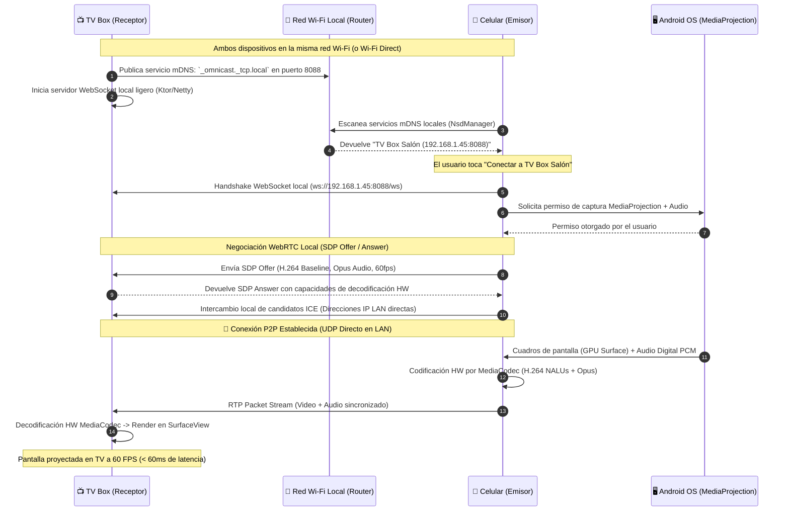

# 📡 PROYECTO DE INGENIERÍA: OMNICAST PRO
## Sistema Universal de Proyección y Transmisión de Pantalla y Audio (Móvil a TV Box)

> **Versión:** 1.0 — Especificación Técnica y Arquitectura de Producción  
> **Inspirado en:** Estándares de Arquitectura e Ingeniería de `boot-ventas-saas`, `marketplace-saas` y `app-ofertas`  
> **Estado:** Fase 0 (Diseño de Arquitectura y Especificación Técnica)  
> **Fecha:** Septiembre 2026  

---

## 1. RESUMEN EJECUTIVO Y DIAGNÓSTICO DEL PROBLEMA

### 1.1 El Problema Fundamental
Actualmente, los usuarios que intentan reproducir o proyectar aplicaciones desde su teléfono móvil hacia una TV Box se enfrentan a un **muro tecnológico de tres factores**:

1. **Ausencia de Soporte de Cast en las Aplicaciones Emisoras:**
   - La inmensa mayoría de aplicaciones móviles (redes sociales como TikTok e Instagram, emuladores de videojuegos, apps de videoconferencia, suites ofimáticas, navegadores web, galerías privadas y reproductores multimedia locales o IPTV) **no incorporan el SDK de Google Cast**.
   - Algunas plataformas de streaming restringen o deshabilitan intencionalmente el botón de casteo en sus versiones móviles.

2. **Carencia de Certificación en las TV Box del Mercado:**
   - La gran mayoría de TV Boxes comerciales (procesadores Amlogic S905, Rockchip RK3318/RK3566, Allwinner H6/H616, Xiaomi Mi Box con ROM genérica, Fire TV Stick, etc.) ejecutan versiones de **Android AOSP** (Android Open Source Project) sin certificación de Google Cast Receiver.
   - El protocolo oficial de Google Chromecast es **propietario y cerrado**: no se puede instalar de forma libre en dispositivos no certificados sin provocar errores de autenticación o pantalla en negro.

3. **Deficiencias de las Soluciones Existentes de Duplicación (Miracast y Apps Gratuitas):**
   - **Miracast:** Requiere soporte de hardware Wi-Fi Direct que suele estar roto o deshabilitado en chips de TV Box de bajo costo, además de una latencia inestable (250ms - 500ms).
   - **Apps de Screen Mirroring de la Play Store:** Llenas de publicidad intrusiva, requieren conexión a internet externa obligatoria, comprimen el video por software provocando sobrecalentamiento del móvil y TV Box, y capturan el audio a través del micrófono ambiental en lugar de transmitir el audio digital nativo del sistema.

### 1.2 La Solución Propuesta: OmniCast Pro
**OmniCast Pro** es un ecosistema cliente-servidor de código abierto y alto rendimiento diseñado bajo **Clean Architecture**:
- **Emisor Móvil (Android Sender App):** Captura a nivel de sistema operativo mediante las APIs nativas `MediaProjection` y `AudioPlaybackCaptureConfiguration` (Android 10+), permitiendo proyectar **cualquier aplicación sin excepción**.
- **Motor de Transporte Local (Ultra-Low Latency Engine):** Transmisión P2P directa sobre la red Wi-Fi local mediante **WebRTC con aceleración por hardware (MediaCodec)**. Latencia ultra-baja (**< 80 ms**), 60 FPS estables y cero consumo de datos de internet.
- **Receptor TV Box (Android TV Receiver App):** Aplicación optimizada para interfaz Leanback y control remoto D-Pad, con decodificación directa por hardware a `SurfaceView` y descubrimiento automático cero-configuración vía **mDNS / NSD**.

---

## 2. OBJETIVOS DEL PROYECTO

### 2.1 Objetivos Funcionales

| Módulo | Funcionalidad | Descripción Técnica |
|---|---|---|
| **Captura Universal** | Proyección de Cualquier App | Captura de búfer de pantalla vía `MediaProjection` sin importar si la app tiene botón de Cast. |
| **Audio Interno Digital** | Captura de Sonido del Sistema | Captura digital directa vía `AudioPlaybackCapture` (Android 10+) a 48kHz estéreo, sin capturar ruido de ambiente. |
| **Cero Configuración** | Descubrimiento Automático LAN | Descubrimiento de la TV Box mediante mDNS/Bonjour (`_omnicast._tcp`). El usuario pulsa un botón y conecta en < 1 segundo. |
| **Control Flotante** | Burbuja / Overlay Móvil | Menú flotante que permite pausar, reanudar, cambiar orientación, mutear y ajustar calidad sin salir de la app que se está proyectando. |
| **Selección de Resolución** | Calidad Dinámica Adaptativa | Modos seleccionables: Modo Fluidez (720p @ 60fps, 4Mbps), Modo Cine (1080p @ 60fps, 12Mbps) y Modo Ultra (4K @ 30/60fps, 20Mbps). |
| **Navegación D-Pad en TV** | Interfaz Leanback TV | Pantalla principal de la TV Box controlable al 100% con el control remoto tradicional, mostrando estado de conexión, código PIN y bitrate en vivo. |
| **Canal Inverso de Control (Opcional)** | Remote Control Back to Phone | Capacidad de enviar eventos de teclado/ratón desde el control de la TV hacia el teléfono utilizando Accesibility Service / ADB local. |

### 2.2 Objetivos No Funcionales (Criterios de Calidad)

| Criterio | Métrica Objetivo | Justificación Técnica |
|---|---|---|
| **Latencia Extremo a Extremo** | **< 80 ms (Objetivo: 45–65 ms)** | Indispensable para navegación fluida, interacción táctil en tiempo real y sincronización labial (Lip-Sync). |
| **Tasa de Cuadros** | **60 FPS estables** | Fluidez cinematográfica y apta para videojuegos casuales y scroll en redes sociales. |
| **Autonomía y Recursos** | CPU < 12% en Móvil, CPU < 18% en TV Box | Codificación y decodificación forzada por hardware con chipsets Qualcomm, MediaTek, Exynos y Amlogic. |
| **Independencia de Internet** | **100% Offline-Capable** | Toda la señalización y el streaming de medios operan en la subred local (LAN 192.168.x.x / 10.x.x.x). |
| **Resiliencia de Red** | Adaptación a Jitter Wi-Fi | Integración de algoritmos WebRTC GCC (Google Congestion Control) y NACK/FEC para evitar freezeos. |

---

## 3. EVALUACIÓN Y SELECCIÓN DE TECNOLOGÍA

Para garantizar la mejor solución técnica, se evaluaron cinco alternativas arquitectónicas de transmisión:

| Tecnología | Latencia Promedio | Calidad de Audio | Independencia de Cast | Soporte en TV Box AOSP | Consumo de CPU | Veredicto |
|---|---|---|---|---|---|---|
| **Google Cast SDK** | 400 - 900 ms | Excelente | ❌ No (Solo apps autorizadas) | ❌ Nulo en TV Boxes no certificados | Bajo | **Descartado:** No resuelve el problema del usuario. |
| **Miracast (Wi-Fi Direct)** | 180 - 450 ms | Regular | ✅ Sí (Todo el sistema) | ⚠️ Inestable (Drivers Wi-Fi incompatibles) | Medio | **Descartado:** Fallas frecuentes en chipsets chinos. |
| **HLS / DASH (Streaming Web)** | 2.000 - 6.000 ms | Alta | ✅ Sí | ✅ Alto | Medio | **Descartado:** Latencia inaceptable para interacción. |
| **RTSP / SRT (Raw Stream)** | 120 - 250 ms | Alta | ✅ Sí | ✅ Bueno | Bajo | **Alternativa secundaria:** Buena pero requiere buffers mayores. |
| **WebRTC P2P + MediaCodec HW** | **35 - 75 ms** | **Nativa 48kHz (Opus)** | **✅ Sí (100% Universal)** | **✅ Excelente (Aceleración HW)** | **Mínimo (<10%)** | **👑 TECNOLOGÍA GANADORA (Seleccionada)** |

### 💡 Justificación de la Elección: WebRTC P2P Local + Hardware MediaCodec
1. **Ultra-Baja Latencia Sub-100ms:** WebRTC fue diseñado para comunicaciones interactivas en tiempo real. Utiliza RTP sobre UDP con buffers de fotogramas ultracortos.
2. **Sincronización A/V Perfecta:** Maneja internamente los timestamps de audio y video mediante RTCP SR (Sender Reports), garantizando que el sonido coincida exactamente con la imagen en pantalla.
3. **Aceleración por Hardware:** La integración con la API `MediaCodec` de Android permite inyectar directamente la `Surface` generada por `VirtualDisplay` al codificador H.264/H.265 del chip móvil, y recibirla en la TV Box enviándola directamente al decodificador de hardware y renderizarla sobre una `SurfaceView`.

---

## 4. ARQUITECTURA DEL SISTEMA (CLEAN ARCHITECTURE)

Siguiendo las normas establecidas en los proyectos de referencia (`marketplace-saas` y `app-ofertas`), el sistema se divide en capas estrictamente desacopladas para ambas plataformas:

```
┌─────────────────────────────────────────────────────────────────────────┐
│                           CAPA DE PRESENTACIÓN                          │
│   [Móvil]                                      [TV Box]                 │
│   • MainActivity (Configuración & Conexión)    • TvMainActivity         │
│   • FloatingOverlayBubble (Burbuja Flotante)   • TvLeanbackDashboard    │
│   • NotificationServiceController              • VideoPlayerSurfaceView │
└─────────────────────────────────────────────────────────────────────────┘
                                     │
                                     ▼
┌─────────────────────────────────────────────────────────────────────────┐
│                           CAPA DE APLICACIÓN                            │
│   • IniciarProyeccionUseCase                   • RecibirTransmisionUseCase
│   • DescubrirDispositivosLanUseCase            • PublicarServiciomDNSUseCase
│   • AjustarCalidadDinamicaUseCase              • SincronizarAudioVideoUseCase
│   • DetenerProyeccionUseCase                   • ManejarControlRemotoUseCase
└─────────────────────────────────────────────────────────────────────────┘
                                     │
                                     ▼
┌─────────────────────────────────────────────────────────────────────────┐
│                           CAPA DE DOMINIO (CORE)                        │
│   • Entities: StreamSession, DeviceTarget, StreamProfile, CodecConfig   │
│   • Value Objects: Resolution(1080p), FrameRate(60fps), Bitrate(12Mbps) │
│   • Ports (Interfaces):                                                 │
│       - IScreenCaptureEngine                   - IAudioCaptureEngine    │
│       - IHardwareEncoder                       - IHardwareDecoder       │
│       - ILocalSignalingTransport               - IServiceDiscovery      │
└─────────────────────────────────────────────────────────────────────────┘
                                     │
                                     ▼
┌─────────────────────────────────────────────────────────────────────────┐
│                       CAPA DE INFRAESTRUCTURA                           │
│   • AndroidMediaProjectionAdapter (Android SDK nativo)                  │
│   • AndroidAudioPlaybackCaptureAdapter (AudioRecord API)                │
│   • HardwareMediaCodecAdapter (H.264 / HEVC / Opus)                     │
│   • LocalWebRtcAdapter (PeerConnection, DataChannel, MediaStream)        │
│   • NsdManagerDiscoveryAdapter (mDNS / Bonjour en LAN)                  │
│   • EmbeddedKtorSignalingServer (WebSocket local puerto 8088 en TV Box) │
└─────────────────────────────────────────────────────────────────────────┘
```

---

## 5. FLUJO DE COMUNICACIÓN Y SECUENCIA P2P LOCAL



---

## 6. CARACTERÍSTICAS TÉCNICAS INNOVADORAS

### 6.1 Captura de Audio Digital Interno (Sin Ruido Ambiente)
La mayoría de herramientas graban el micrófono del celular, lo que capta ruidos de la habitación, eco y baja calidad. OmniCast Pro implementa `AudioPlaybackCaptureConfiguration`:
- Filtra el audio de aplicaciones multimedia excluyendo el micrófono físico.
- Muestreo a **48,000 Hz en estéreo** codificado en **Opus de 128 kbps**.
- Resultado: El sonido de los juegos, música o videos se escucha en los altavoces de la televisión con fidelidad digital idéntica al original.

### 6.2 Widget de Control Flotante (Floating Bubble)
Mientras el usuario utiliza cualquier aplicación en su teléfono (navegando por redes sociales, ejecutando un juego o revisando documentos), una burbuja flotante semitransparente permanece accesible para:
- **Pausar / Reanudar:** Congela la pantalla en la TV si el usuario necesita consultar datos privados o contraseñas.
- **Audio Routing:** Alternar si el sonido suena en la TV, en el teléfono o en ambos al mismo tiempo.
- **Selector de Calidad al Vuelo:** Cambiar entre 720p (Ultra Fluido para juegos) o 1080p (Alta definición para videos).
- **Desconectar:** Finalizar la transmisión con un solo toque.

### 6.3 Decodificación por Hardware Cero-Esfuerzo en TV Box
Los TV Boxes económicos suelen recalentarse si se utiliza decodificación por software (FFmpeg vía CPU). OmniCast Pro utiliza un pipeline nativo en C++/Kotlin que alimenta los búferes de entrada del `MediaCodec` del chip receptor (Amlogic/Rockchip/Allwinner), entregando la salida directamente al hardware compositor `SurfaceView`. La temperatura del TV Box se mantiene normal y el consumo de CPU permanece por debajo del 15%.
